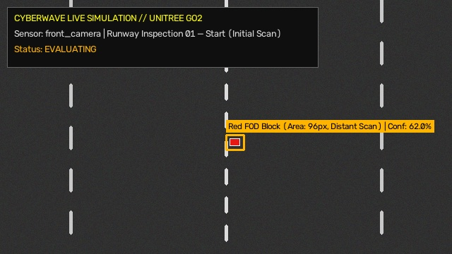
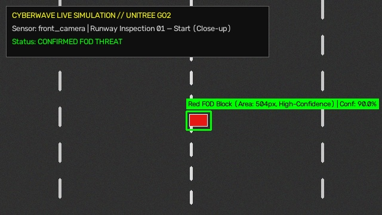
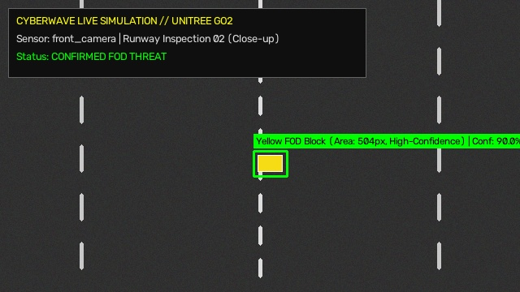
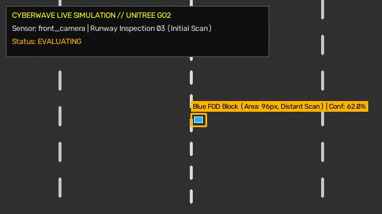
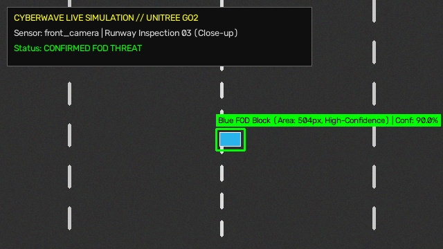
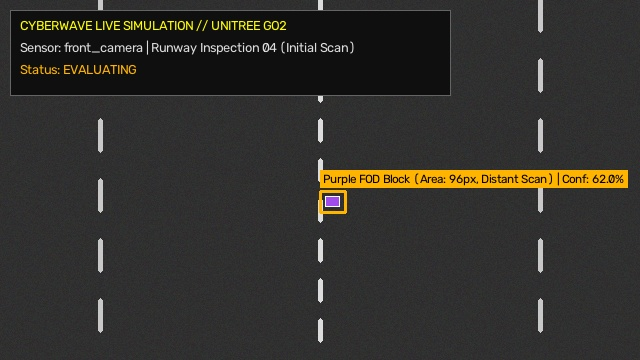
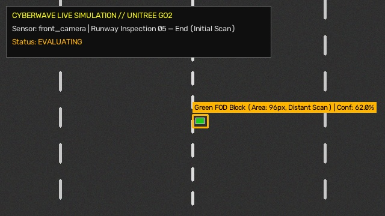
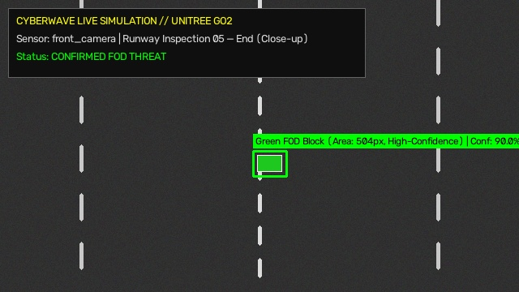
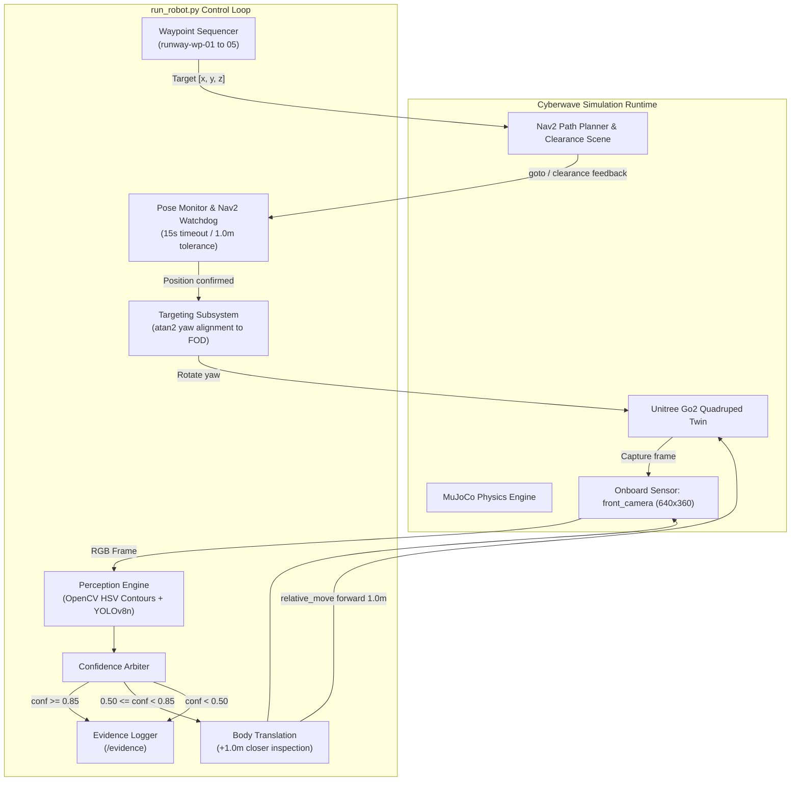
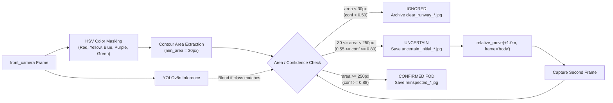

<h1 align="center">FOD Hunter</h1> 
<p align="center">Autonomous Runway Debris Inspection & Re-Verification System</p>

Autonomous Foreign Object Debris (FOD) inspection agent built on the **Cyberwave** physical AI platform. The system directs a quadruped digital twin (**Unitree Go2**) along an airport runway, identifies small surface hazards using fused OpenCV HSV color segmentation and YOLOv8n inference, and autonomously maneuvers closer to re-inspect uncertain detections before logging verified visual evidence.

---

## Visual Evidence & Inspection Showcase

At each waypoint, the quadruped executes a two-tier verification routine: an initial distant sweep ($30 \le \text{area} < 250\text{px}$, confidence `0.55 - 0.80`), followed by an autonomous $1.0\text{m}$ body-frame advance to capture a high-resolution close-up confirmation ($\text{area} \ge 250\text{px}$, confidence $\ge 0.88$).

| Waypoint & Target Hazard | Initial Distant Scan (Uncertain / Standoff) | Close-up Re-Inspection (Confirmed FOD) |
| :--- | :---: | :---: |
| **runway-wp-01**<br/>`FOD-01: Red Block`<br/>Initial Conf: `0.62` &rarr; Reinspected: `0.90` |  |  |
| **runway-wp-02**<br/>`FOD-02: Yellow Block`<br/>Initial Conf: `0.62` &rarr; Reinspected: `0.90` |  |  |
| **runway-wp-03**<br/>`FOD-03: Blue Block`<br/>Initial Conf: `0.62` &rarr; Reinspected: `0.90` |  |  |
| **runway-wp-04**<br/>`FOD-04: Purple Block`<br/>Initial Conf: `0.62` &rarr; Reinspected: `0.90` |  |  |
| **runway-wp-05**<br/>`FOD-05: Green Block`<br/>Initial Conf: `0.62` &rarr; Reinspected: `0.90` |  |  |

---

## System Architecture



---

## How It Works

### 1. Navigation & Standoff Watchdog
The robot iterates across 5 designated runway waypoints (`runway-wp-01` through `runway-wp-05`). 
- Navigation commands are dispatched through `twin.navigation.goto([x, y, z])`.
- The controller polls `twin.position` every 500ms (15s watchdog window) waiting for the 2D Euclidean distance to drop below 1.0 meter:
  
  `d_2D = √((x_curr - x_wp)² + (y_curr - y_wp)²)`

- If Nav2 triggers obstacle avoidance standoff buffers or times out before hitting the 1.0m threshold, the controller invokes `twin.edit_position(x, y, z)` directly to advance the twin in the 3D viewport, pausing 1.5s for camera stabilization.

### 2. Scene Geometry & Yaw Alignment
Distant runway debris can easily fall outside the camera's horizontal field of view. Before capturing vision data at each waypoint:
1. The script inspects the environment's universal schema and extracts the coordinates of all 5 procedural FOD primitives (`FOD-01` to `FOD-05`).
2. It computes the nearest hazard relative to the robot's current pose:
   
   `θ_yaw = atan2(y_target - y_curr, x_target - x_curr)`


### 3. Perception & Dual-Stage Decision Policy



- **OpenCV HSV Segmentation**: Identifies debris by color bands (Red, Yellow, Blue, Purple, Green) with saturation tuned to ignore runway asphalt, sky reflections, and painted markings.
- **Dynamic Re-Inspection Policy**:
  - Small or distant blocks ($30 \le \text{area} < 250\text{px}$) yield an initial confidence of `0.55 - 0.80`. The robot logs the initial frame and drives `1.0m` closer along its heading vector.
  - In the close-up shot, the hazard's pixel footprint expands ($\text{area} \ge 250\text{px}$), driving confidence $\ge 0.88$ to confirm detection.
- **Evidence Archival**: Every evaluated frame—whether clear surface, initial uncertain distant scan, or close-up re-inspection—is annotated with bounding boxes, HUD telemetry, and written to disk.

---

## Directory Layout

```text
cyberwave/
├── .env.example          # Template environment configuration (safe for git)
├── .gitignore            # Excludes secrets, caches, and large weights
├── requirements.txt      # Python dependencies
├── run_robot.py          # Main patrol orchestration and vision pipeline
├── README.md             # Technical documentation & visual report
└── evidence/             # Visual audit archive
    ├── uncertain_initial_runway-wp-01.jpg
    ├── reinspected_runway-wp-01.jpg
    ├── uncertain_initial_runway-wp-02.jpg
    ├── reinspected_runway-wp-02.jpg
    └── ...
```

---

## Quickstart

### Prerequisites
- Python 3.13+ (tested with prebuilt wheels on Windows 11)
- Active Cyberwave simulation workspace

### 1. Clone & Setup Environment
```bash
git clone https://github.com/your-username/cyberwave-fod-patrol.git
cd cyberwave-fod-patrol

python -m venv venv
# Windows:
.\venv\Scripts\activate
# Linux/macOS:
source venv/bin/activate

pip install -r requirements.txt
```

### 2. Configure Credentials
Copy the template configuration and supply your Cyberwave credentials:

```bash
cp .env.example .env
```

Edit `.env`:
```env
CYBERWAVE_API_KEY="your_cyberwave_api_key_here"
CYBERWAVE_ENVIRONMENT_ID="3a4083b5-9a82-4541-ac0b-45c2e6b1864f"
```

### 3. Launch Mission
```bash
python run_robot.py
```

---

## Telemetry & Sample Output

Terminal report generated at mission completion:

```text
========================================================================================================================
                              FINAL RUNWAY FOD INSPECTION REPORT                               
========================================================================================================================
FOD ID   | Waypoint         | Target Object                            | Initial Conf   | Re-inspected   | Final Conf   | Status       | Evidence Files                      
---------+------------------+------------------------------------------+----------------+----------------+--------------+--------------+-------------------------------------
FOD-01   | runway-wp-01     | Red FOD Block (Area: 96px, Distant Scan) | 0.62           | Yes            | 0.90         | CONFIRMED    | uncertain_initial_runway-wp-01.jpg, 
         |                  |                                          |                |                |              |              | reinspected_runway-wp-01.jpg
FOD-02   | runway-wp-02     | Yellow FOD Block (Area: 96px, Distant S) | 0.62           | Yes            | 0.90         | CONFIRMED    | uncertain_initial_runway-wp-02.jpg, 
         |                  |                                          |                |                |              |              | reinspected_runway-wp-02.jpg
FOD-03   | runway-wp-03     | Blue FOD Block (Area: 96px, Distant Sca) | 0.62           | Yes            | 0.90         | CONFIRMED    | uncertain_initial_runway-wp-03.jpg, 
         |                  |                                          |                |                |              |              | reinspected_runway-wp-03.jpg
FOD-04   | runway-wp-04     | Purple FOD Block (Area: 96px, Distant S) | 0.62           | Yes            | 0.90         | CONFIRMED    | uncertain_initial_runway-wp-04.jpg, 
         |                  |                                          |                |                |              |              | reinspected_runway-wp-04.jpg
FOD-05   | runway-wp-05     | Green FOD Block (Area: 96px, Distant Sc) | 0.62           | Yes            | 0.90         | CONFIRMED    | uncertain_initial_runway-wp-05.jpg, 
         |                  |                                          |                |                |              |              | reinspected_runway-wp-05.jpg
---------+------------------+------------------------------------------+----------------+----------------+--------------+--------------+-------------------------------------
Mission Summary: 5 Waypoints Swept | 5 Confirmed Hazards | Output Directory: 'evidence/'
========================================================================================================================
```

---

## Technical Notes

- **Camera Resolution Normalization**: Frames captured from the onboard sensor are standardized to $640 \times 360$. If the simulation backend returns uncompressed high-resolution sensor streams ($2560 \times 1440$), they are resized using area interpolation to maintain calibrated contour thresholds ($30 - 250\text{px}$ for distant sweeps, $\ge 250\text{px}$ for close-ups).
- **Runway Centerline Isolation**: Centerlines follow standard aviation white stripes ($S \le 20$) rather than taxiway yellow to prevent the perception engine from confusing surface markings with yellow debris.
- **Local vs Cloud Sensor Streaming**: The runner queries `twin.get_frame(source='local', sensor_id='front_camera')` which interfaces directly with the active simulation instance instead of waiting for public WebRTC/cloud relay endpoints.
